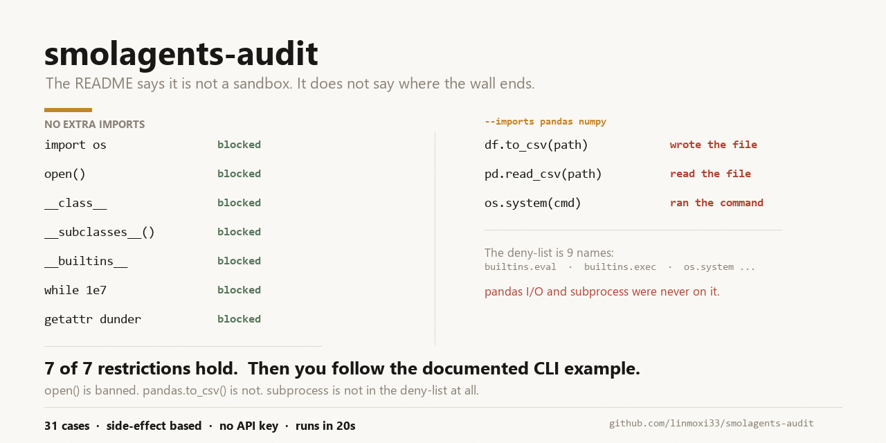

# smolagents-audit



**核验 `huggingface/smolagents` 宣传的能力是否真的存在、是否真的有效，并给出可重复的证据。**

不需要 LLM API key。不需要 Docker。一条命令出结论。

```bash
pip install -e ".[libs,dev]"
python -m smolagents_audit
```

---

## 为什么要做这个

`smolagents` 有 29.9k star，README 写着「a barebones library for agents that think in code」，并且明确承认：

> The built-in `LocalPythonExecutor` is **not a security sandbox**. It applies some restrictions but can be bypassed and must not be used as a security boundary.

这句话很诚实。但「能绕过」到底绕到什么程度？普通用户读完 README 只知道「别拿它跑不可信代码」，却不知道**在自己机器上按官方示例配置时，边界具体在哪**。

本项目把这个问题变成一组可执行的断言。

---

## 核验结论（v1.26.0 / Windows 11 / Python 3.13.14）

整体判定：**FAIL** —— 有 7 项与宣传/预期直接矛盾。

### 宣传声明核验

| ID | 声明 | 状态 | 实测证据 |
|---|---|---|---|
| C1 | agents.py 逻辑「约 1,000 行」 | **PARTIAL** | 有效代码 **1,255 行**（去空行/注释/docstring），超出 25% |
| C2 | 支持 Blaxel / E2B / Modal / Docker 四种沙箱 | IMPLEMENTED | 四个类均存在于 `remote_executors.py` |
| C3 | 每种沙箱有对应 extras | IMPLEMENTED | `blaxel` / `e2b` / `modal` / `docker` 四个 extra 齐全 |
| C4 | 沙箱隔离可实机验证 | **UNVERIFIABLE** | 本机无 docker/deno，无云端凭证。仅静态核查 |
| C5 | Docker 沙箱默认做容器加固 | **PARTIAL** | **默认加固项 0/6**：无 `network_disabled`、无 `mem_limit`、无 `cap_drop`、无 `no-new-privileges`、非只读、非非 root |
| C6 | 与 Hub 共享/拉取 tool 与 agent | IMPLEMENTED | `Tool.from_hub` / `push_to_hub` / `from_space` / `Agent.from_hub` 全在 |
| C7 | 支持任意 LLM | IMPLEMENTED | `models.py` 定义 14 个 Model 类 |
| C8 | 支持 text / vision / **video** / audio | **MISMATCH** | image ✅ audio ✅，但**整个包源码中 `video` 出现 0 次** |
| C9 | 可用 MCP / LangChain / Hub Space 作工具 | IMPLEMENTED | 三个入口方法均存在 |
| C10 | 提供 `smolagent` / `webagent` CLI | IMPLEMENTED | `console_scripts` 已声明 |
| C11 | 危险函数黑名单覆盖系统命令入口 | **MISMATCH** | 黑名单 9 条，但 `os.system`（Windows 上 `__module__='nt'`）与 **`subprocess` 全家族**都不在其中 |

### 沙箱隔离核验（核心）

| ID | 能力 | 状态 | 实测证据 |
|---|---|---|---|
| A1–A7 | 未授权时的高危操作应被拦 | **全部 IMPLEMENTED** | `import os` / `open()` / dunder / `getattr` / `subclasses` / `__builtins__` / 死循环，7 项全部拦截 |
| **B1** | 授权 pandas 后不应能写任意路径 | **MISMATCH** | `df.to_csv(r'任意路径')` **成功写入**，文件真实落盘 |
| **B2** | 授权 numpy 后不应能写任意路径 | **MISMATCH** | `np.savetxt(r'任意路径')` **成功写入** |
| **B3** | 授权 pandas 后不应能读任意文件 | **MISMATCH** | `pd.read_csv(r'任意路径')` **读到真实内容** `{'name': {'0': 'alice'...}}` |
| B4 | 访问 `pandas.io` 子模块应被拦 | IMPLEMENTED | `Forbidden access to module: pandas.io` |
| **E1** | 授权 os 后不应能执行系统命令 | **MISMATCH** | `os.system(...)` **真的执行**，标记文件被创建 |
| **E2** | 授权 subprocess 后不应能执行系统命令 | **MISMATCH** | `subprocess.run(..., shell=True)` **returncode=0** |
| D1 | 1GB 内存分配应被限制 | PARTIAL | 无内存上限，`'a' * 10**9` 分配成功 |
| D2 | print 输出应被截断 | IMPLEMENTED | 事后截断到 50,000 字符 |

### 三条最重要的发现

**1. `open()` 被禁，但 `pd.read_csv()` / `df.to_csv()` 畅通无阻**

这是最关键的一条。执行器拦住了 `open`，却没拦住「库自带的文件 I/O」。
而 README 的 CLI 示例恰好写着：

```bash
smolagent "Plan a trip to Tokyo..." --imports pandas numpy
```

**按官方示例配置，就等于交出了任意文件读写权。**

**2. Windows 上 `os.system` 的黑名单失效（根因已定位）**

`DANGEROUS_FUNCTIONS` 里明列了 `"os.system"`，但拦截代码是这么写的：

```python
if result.__name__ == function_name and result.__module__ == module_name:
    raise InterpreterError(...)
```

而 Windows 上：

```
>>> os.system.__module__
'nt'
```

黑名单要求 `__module__ == "os"`，实际是 `"nt"` —— **精确匹配落空，拦截完全失效**。
上游自己的测试 `test_vulnerability_for_all_dangerous_functions[os.system]` 在 Windows 上**基线就是红的**，说明这个问题早已存在但未被处理。

更进一步：**整个 `subprocess` 家族（`run` / `Popen` / `call` / `check_output`）根本不在黑名单里**，任何平台授权后都能执行命令。这比平台差异更严重——不是「某平台漏了」，而是「这一类入口从来没被覆盖」。

**3. 框架会主动把人引向不安全配置**

`agents.py:1747` 在 import 被拦时打印：

> Consider passing said import under `additional_authorized_imports`

这条提示**不区分安全模块与危险模块**。用户按提示授予 `os` 后，命令执行即打开。
本套件的 X1→X2→X3 用例把这条升级链完整复现了。

---

## 测试覆盖核验（变异测试）

「有测试」≠「测试有效」。本套件对上游源码做定点变异，看测试是否真的会红。

方法上有个坑值得记录：第一版用「失败数量 > 0」判定，但基线本身就有 1 个平台性失败（Windows 的 `os.system`），导致所有变异都被误判为「检测到」。**必须比较失败用例集合的差集**。

| 变异 | 新增失败 | 判定 |
|---|---|---|
| M1 关闭 `evaluate_attribute` 的 dunder 拦截 | +21 | ✅ 有覆盖 |
| M2 关闭 `nodunder_getattr` 的 dunder 拦截 | **0** | ❌ **无覆盖** |
| M3 关闭 while 迭代上限 | +1 | ✅ 有覆盖 |
| M4 关闭危险函数黑名单 | +9 | ✅ 有覆盖 |
| M5 关闭导入白名单校验 | +32 | ✅ 有覆盖 |

**M2 是真实测试缺口，不是死代码**。直接对比行为可以证明：

```
变异前: getattr((), '__class__')  →  InterpreterError: Forbidden access to dunder attribute
变异后: getattr((), '__class__')  →  <class 'tuple'>        ← 防线消失
```

防线真的存在、真的会失效，但 396 个测试无一失败。

> 注：M2/M3 首次用 `-k vulnerability` 过滤时被判为「无覆盖」，是因为测试名不含该关键词被排除了。**全量重跑后 M3 才显示 +1**。过滤范围会直接改变结论，这类判定必须跑全量。

---

## 复现

```bash
# 全部核验（约 20 秒）
python -m smolagents_audit

# 只核验宣传声明（不执行任何代码）
python -m smolagents_audit --claims

# 只测沙箱隔离
python -m smolagents_audit --sandbox

# 出报告
python -m smolagents_audit --json report.json --md report.md

# 回归门禁：只对 baseline.json 未登记的新问题失败
# （本审计的职责就是找出问题，对已知问题反复报红只会让人忽略红色）
python -m smolagents_audit --quiet --fail-on-new

# 严格模式：任何 MISMATCH 都失败
python -m smolagents_audit --fail-on MISMATCH,GAP
```

退出码：`0` 正常，`1` 命中门禁。

### 判定不依赖「是否抛异常」

所有涉及文件/命令的用例都以**真实副作用**为准：先删哨兵文件 → 执行 → 检查文件是否被创建。
因为「抛了异常但文件已写入」= 逃逸成功，只看异常会得出完全相反的结论。

---

## 设计取舍

**为什么状态要分 6 档，而不是「通过/不通过」**

`PARTIAL`（实现存在但只在部分条件成立）和 `MISMATCH`（源码与宣传直接矛盾）是两种完全不同的问题，混在一起会掩盖真问题。`UNVERIFIABLE` 单独列出，是为了不把「我没条件测」伪装成「它不行」。

**为什么不用 LLM**

核心能力是代码执行隔离，这完全可以脱离 LLM 直接测 `LocalPythonExecutor`。
引入 LLM 会让结果不确定、需要 API key、还掩盖真正要验证的东西。

**本套件不做什么**

- 不评价 E2B / Modal / Blaxel 的隔离质量（本机无凭证，无法实测，标 `UNVERIFIABLE`）
- 不构造完整的沙箱逃逸链（只验证「边界在哪」，不做武器化）
- 不修改上游代码（变异测试会临时改动，跑完按字节校验恢复）

---

## 目录

```
smolagents_audit/
  model.py          # 6 档状态 + 报告 + verdict 逻辑
  claim_suite.py    # 11 条宣传声明 → 可执行断言
  sandbox_suite.py  # 20 条隔离用例（A/B/E/D/X 五组）
  baseline.py       # 已知问题台账（CI 只对新增失败）
  cli.py            # 命令行入口
  reporters/        # 终端 + Markdown 渲染
tests/
  test_suite_logic.py  # 18 项，测「判定逻辑本身是否可靠」
baseline.json          # 7 项已登记的 MISMATCH
docs/SAMPLE_REPORT.md  # 本机实测输出快照
```

---

## 许可

MIT。本项目是独立核验工具，与 Hugging Face 无关联。

核验对象：`smolagents` 1.26.0（Apache-2.0）。
所有结论基于 2026-10-19 的实测，上游版本更新后需重跑。
